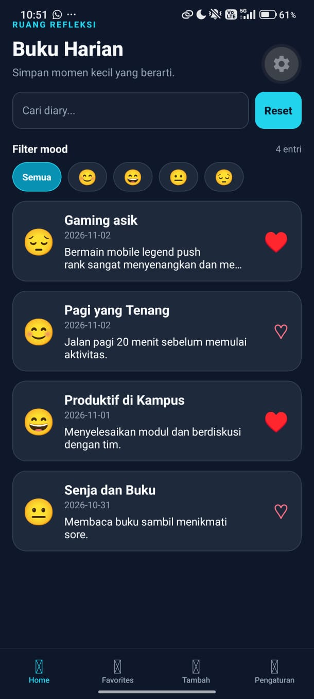
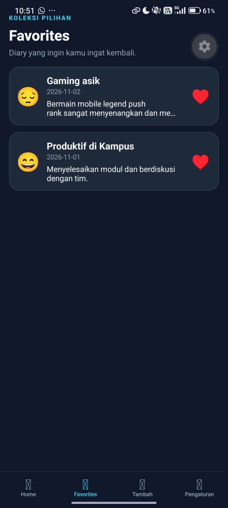
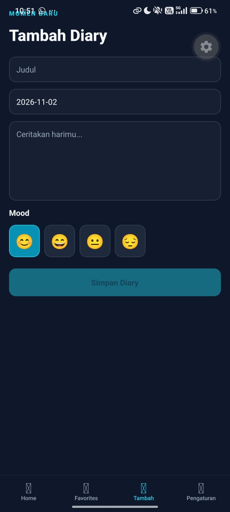
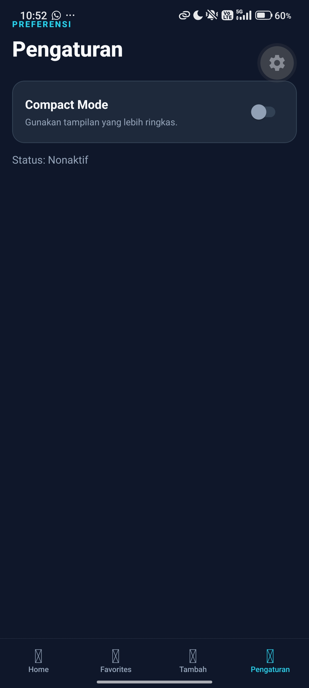

# Diary App

- Nama: Naufal Alexander
- NIM: 2430511010
- Kelas: 5A
- Mata Kuliah: Pemrograman Mobile Multiplatform

Aplikasi diary mobile berbasis Expo dan React Native untuk mencatat momen harian, menandai entri favorit, serta melakukan pencarian dan filter berdasarkan mood.

## Fitur Utama

- Halaman Home dengan pencarian teks
- Filter mood
- Tombol reset filter
- Tab Favorites untuk menampilkan diary yang disukai
- Detail diary untuk melihat isi penuh entri
- Sinkronisasi like antar halaman menggunakan Context API

## Cara Menjalankan Project

1. Pastikan Node.js dan Expo CLI sudah terinstal.
2. Buka terminal di folder project.
3. Install dependency:

```bash
npm install
```

4. Jalankan aplikasi:

```bash
npx expo start
```

5. Pilih salah satu opsi berikut:
   - Android emulator
   - iOS simulator
   - Expo Go di perangkat Anda

Jika terjadi masalah dependency atau versi SDK:

```bash
npx expo install
```

## Struktur Project

```text
.
├── app/
├── assets/
├── components/
├── constants/
├── package.json
├── tsconfig.json
├── app.json
└── README.md
```

## Screenshot Hasil

Gunakan folder `assets/screenshots/` dan masukkan gambar hasil kerja Anda di sini agar tampilan README tetap rapi.

### Template Screenshot

| No  | Screenshot                                           | Keterangan                |
| --- | ---------------------------------------------------- | ------------------------- |
| 1   |     | Halaman utama diary       |
| 2   |  | Daftar diary favorit      |
| 3   |     | Detail entri diary        |
| 4   |  | Pencarian dan filter mood |

> Catatan: ganti nama file gambar sesuai dengan file yang Anda simpan di folder `assets/screenshots/`.

## Tabel Penjelasan Hooks

| Hook              | Input                             | Output                                         | Dependency                  | Alasan Pemilihan                                                                     |
| ----------------- | --------------------------------- | ---------------------------------------------- | --------------------------- | ------------------------------------------------------------------------------------ |
| `useState`        | nilai awal seperti query dan mood | state dan setter                               | tidak ada                   | Menyimpan status input pencarian dan filter mood secara lokal pada screen            |
| `useContext`      | `DiaryContext`                    | `entries`, `likedIds`, `toggleLike`, `getById` | Provider global             | Agar data diary dan status like bisa diakses oleh seluruh screen tanpa prop drilling |
| `useMemo`         | `entries`, `query`, `mood`        | `filteredEntries`                              | data diary dan filter aktif | Menghindari perhitungan filter berulang saat render dan menjaga performa             |
| `useCallback`     | fungsi navigasi dan id            | `openDetail`, `resetFilter`                    | `router` atau state kosong  | Menjaga fungsi tetap stabil antar render dan mengurangi re-creation fungsi           |
| `useRef`          | referensi `TextInput`             | `searchRef.current`                            | tidak ada                   | Digunakan untuk fokus / blur input saat tombol reset ditekan                         |
| `useDiarySearch`  | `entries`, `query`, `mood`        | `{ filteredEntries, resultCount }`             | `entries`, `query`, `mood`  | Memusatkan logic pencarian dan filter pada custom hook agar reusable                 |
| `useLikedEntries` | `entries`, `likedIds`             | list diary yang disukai                        | `entries`, `likedIds`       | Menyederhanakan pemfilteran data favorit untuk tab Favorites                         |

## Catatan Pengembangan

Project ini dibangun dengan Expo Router untuk navigasi tab dan detail screen. Pengelolaan data utama disimpan dalam Context API agar status like tetap sinkron di Home, Favorites, dan Detail.

## Lisensi

Proyek ini dibuat untuk kebutuhan tugas praktikum dan dapat dimodifikasi sesuai kebutuhan pembelajaran.
